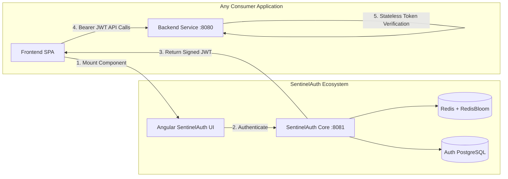

# 🛡️ SentinelAuth: Zero-Trust Autonomous Identity & Security Engine

> **Universal, Self-Defending Authentication Gateway & Reusable Single-Sign-On (SSO) Component**  
> *Engineered with Spring Boot 3, RedisBloom, PostgreSQL 16, BIP-39 Mnemonics, Polygon Merkle Anchors, and Angular 18+ Anti-Capture Directives.*

---

## 1. Project Purpose & Core Ideology

### The Problem
Most modern applications treat authentication as an afterthought. Teams repeatedly build custom login forms from scratch, leaving applications vulnerable to:
* **Credential Stuffing & Brute Force Attacks**: Missing rate-limiting, allowing millions of automated credential guesses.
* **Password Reuse Vulnerabilities**: Users repeatedly recycle compromised passwords across services.
* **Insecure Recovery Workflows**: SMS and email OTPs are susceptible to SIM swapping, phishing, and man-in-the-middle interception.
* **Internal Log Tampering**: In standard databases, a rogue administrator or compromised server can alter access logs to erase unauthorized activity.
* **Client-Side Data Leakage**: In-browser session data and credentials can easily be recorded, screenshotted, or printed without audit trails.

### The SentinelAuth Manifesto: "Autonomous, Sovereign, and Pluggable"
SentinelAuth was created to be a **universal, drop-in security component** that can be integrated into *any* backend and frontend stack without rewriting authentication logic.

```
┌──────────────────────────────────────────────────────────────────────────────┐
│                            SENTINELAUTH CORE IDEOLOGY                        │
├──────────────────────────────────────────────────────────────────────────────┤
│ 1. Zero-Trust Access       │ Trust nothing; verify context on every attempt.  │
│ 2. Probabilistic Defense   │ Block breached & recycled passwords in O(1) RAM.│
│ 3. Sovereign Recovery      │ Give users true offline BIP-39 master keys.     │
│ 4. Immutable Auditability  │ Cryptographically anchor log proofs to Ledger.  │
│ 5. Universal Pluggability  │ Drop into any project with dynamic attributes.  │
│ 6. Viewport Shielding      │ Protect the client from screenshots & prints.   │
└──────────────────────────────────────────────────────────────────────────────┘
```

---

## 2. The 6 Pillars of SentinelAuth Security

```mermaid
flowchart TD
    Client[Client Browser / Mobile] -->|1. Credentials + CAPTCHA| Gateway[SentinelAuth Gateway]
    
    subgraph DefenseLayer [Autonomous Defense Pipeline]
        Gateway -->|Check IP & Attempts| RateLimit[Redis Sliding Rate Limiter]
        RateLimit -->|Passes Checks| Bloom[RedisBloom Filter]
        Bloom -->|O(1) Breached & History Check| DB[(PostgreSQL 16)]
    end

    subgraph SecurityChecks [Verification & Challenges]
        DB -->|Failed > 4 Attempts| Lockout[72-Hour Security Lockout]
        Lockout -->|Google-Style Anomaly| Challenge[6-Digit OTP / Security Question]
        Challenge -->|Verified| Unlock[Self-Service Unblock]
    end

    subgraph AuditLedger [Cryptographic Audit]
        Gateway -.->|Security Events| Merkle[Merkle Tree Engine]
        Merkle -.->|Batch Anchor| Blockchain[(Polygon / Distributed Ledger)]
    end
```

### Pillar 1: Probabilistic Defense (RedisBloom & $O(1)$ Non-Repetition)
* **The Challenge**: Verifying that a new password has never been used by a user across their history typically requires running expensive BCrypt/Argon2 hashing against past records ($\approx 100\text{ ms}$ per candidate password) and storing extensive database tables.
* **The Sentinel Solution**: SentinelAuth uses **RedisBloom** (`BF.EXISTS` / `BF.ADD`). Each user has a dedicated, cryptographic Bloom filter populated with salted digests (`SHA256(userId + ":" + password)`).
* **The Result**: Membership tests execute in sub-millisecond $O(1)$ constant time with a controlled false-positive probability ($p = 0.001$) and **zero false negatives**, reducing RAM overhead by over **98.8%**. A global Bloom filter also screens candidate passwords against known compromised password lists.

### Pillar 2: Strict Lockout & Google-Style Anomaly Detection
* **4-Attempt Threshold**: Attackers attempting credential stuffing are stopped at **4 failed attempts**.
* **72-Hour Automatic Lockout**: On the 5th failed attempt, the account is locked for 72 hours (`Duration.ofHours(72)`).
* **Context-Aware Anomaly Checks**: Incoming requests compare the client IP and User-Agent against `lastKnownIp` and `lastKnownDevice`. An anomalous login triggers a Google-style security challenge.
* **Emergency Unlocking**: Legitimate users can unlock their account during a 72-hour lockout by completing a challenge (6-digit Email/SMS OTP or registered Security Question).

### Pillar 3: User Sovereignty & Offline Master Keys (BIP-39 Mnemonic Passphrase)
* **12-Word Master Recovery Phrase**: At registration, SentinelAuth generates a 12-word cryptographic seed phrase providing **128 bits of entropy**.
* **Offline Security**: If a user forgets their password, they can recover access offline using their mnemonic phrase or one of 5 single-use backup recovery codes (`XXXX-XXXX`).
* **Temporary Password Lifecycle**: Validating a recovery key issues a 24-hour temporary password and flags `must_change_password = true`. The system requires the user to set a permanent password before granting general access.

### Pillar 4: Immutable Auditability (Blockchain Merkle Tree Anchoring)
* **Tamper-Evident Security Logs**: In high-security systems, an attacker who compromises the database could delete audit records.
* **Merkle Root Anchoring**: SentinelAuth collects critical security events (lockouts, resets, registrations), compiles them into a binary Merkle Tree, and anchors the root hash to the Polygon PoS blockchain.
* **Non-Repudiation**: Any attempt to modify historical access logs can be detected by recomputing the Merkle proof against the on-chain root hash.

### Pillar 5: Viewport Shielding & Anti-Capture Directives
* **Focus-Loss Blurring**: When a screen snipping tool or window switch is detected via `@HostListener('window:blur')`, the viewport is obscured with a blur overlay (`backdrop-filter: blur(35px)`).
* **Print Blocking**: Dynamically injected CSS `@media print { body { display: none !important; } }` prevents "Print to PDF" and physical hardcopy leaks.
* **Forensic Watermarking**: An off-screen HTML5 canvas overlays a repeating, semi-transparent watermark displaying `USER ID | IP ADDRESS | TIMESTAMP`, ensuring physical camera captures remain traceable.
* **Shortcut Interception**: Context menus (right-click) and shortcuts (`Ctrl+Shift+I`, `F12`, `Ctrl+P`, `PrintScreen`) are disabled.

### Pillar 6: Universal Pluggability & Extensible Schema
* **Independent Database**: Operates against its own schema (`auth_db`), decoupled from host business domains.
* **Dynamic Attributes (`JSONB`)**: Projects can register custom fields (e.g. `department`, `employeeId`, `tenantId`, `medicalLicenseNo`) without database schema updates.
* **Stateless JWT Validation**: Any consumer service in your ecosystem verifies identity using public key cryptography or symmetric secrets without database queries.

---

## 3. How to Plug SentinelAuth into Any Project



### Backend Integration
1. **Run SentinelAuth Core**: Deploy the container or run via `java -jar sentinel-auth-core.jar`.
2. **Configure Host Security Filter**: In your consumer service (Spring Boot, Express, Django, Go), add a stateless JWT filter:
   ```java
   // In your host project: Verify Bearer token using SentinelAuth JWT Secret
   Claims claims = Jwts.parser()
       .verifyWith(secretKey)
       .build()
       .parseSignedClaims(token)
       .getPayload();
   String userId = claims.get("userId", String.class);
   Boolean mustChange = claims.get("must_change_password", Boolean.class);
   ```
3. **Handle Extensible Fields**: Pass custom signup fields through the `dynamicAttributes` map. SentinelAuth stores them in `users.dynamic_attributes` and reflects them in `/api/v1/users/me`.

### Frontend Integration (Angular)
1. **Import the Module**:
   ```typescript
   import { SentinelAuthModule } from './sentinel-auth/sentinel-auth.module';

   @NgModule({
     imports: [SentinelAuthModule]
   })
   export class AppModule { }
   ```
2. **Mount the Component with Custom Fields**:
   ```html
   <sentinel-register 
     [customFields]="[
       { key: 'department', label: 'Department', type: 'text', required: true },
       { key: 'tier', label: 'Account Tier', type: 'select', options: ['BASIC', 'PRO'] }
     ]"
     (registrationComplete)="onUserEnrolled($event)">
   </sentinel-register>
   ```

---

## 4. Quickstart & Deployment

### Run Locally with Docker Compose
```bash
# Start PostgreSQL 16, Redis Stack (with native RedisBloom), MinIO, and SentinelAuth Core
docker-compose up --build -d
```

### Access Points
* **Swagger OpenAPI Documentation**: [http://localhost:8081/swagger-ui.html](http://localhost:8081/swagger-ui.html)
* **OpenAPI 3 JSON Spec**: [http://localhost:8081/v3/api-docs](http://localhost:8081/v3/api-docs)
* **RedisBloom Stack Server**: `localhost:6379`
* **PostgreSQL Database**: `localhost:5432` (`auth_db`)

### Deploy to Railway (Backend)
1. Connect your GitHub repository to [Railway](https://railway.app).
2. Add a **PostgreSQL** service and a **Redis** service from the Railway marketplace.
3. Railway will automatically detect [railway.toml](railway.toml) and [Dockerfile](Dockerfile) to build the container.
4. Set environment variables:
   * `DB_URL=jdbc:postgresql://${{Postgres.HOST}}:${{Postgres.PORT}}/${{Postgres.DATABASE}}`
   * `DB_USERNAME=${{Postgres.USER}}`
   * `DB_PASSWORD=${{Postgres.PASSWORD}}`
   * `REDIS_HOST=${{Redis.HOST}}`
   * `REDIS_PORT=${{Redis.PORT}}`
   * `REDIS_PASSWORD=${{Redis.PASSWORD}}`

### Deploy to Vercel (Angular UI)
1. The frontend directory contains [vercel.json](sentinel-auth-ui/vercel.json) with single-page application URL rewrites and security response headers.
2. Link the repository to [Vercel](https://vercel.com) and deploy the UI bundle.

---

## 5. Technical Specifications

| Parameter | Configuration |
|:---|:---|
| **Java Version** | OpenJDK 17 LTS (Eclipse Temurin) |
| **Framework** | Spring Boot 3.2.3 |
| **Database** | PostgreSQL 16 Alpine with Flyway Database Migrations |
| **In-Memory Cache & Defense** | Redis 7 + native RedisBloom (via `redis/redis-stack-server`) |
| **Access Token (JWT)** | 15 Minutes (Strict Session Duration) |
| **Refresh Token** | 7 Days (Sliding Window Rotation) |
| **Brute-Force Lockout** | Max 4 Failed Attempts $\rightarrow$ 72-Hour Automatic Lockout |
| **Mnemonic Phrase Standard** | BIP-39 (12-Word Dictionary, 128-bit Entropy) |
| **Blockchain Anchoring** | Merkle Tree Binary Root on Polygon PoS |
| **Frontend Framework** | Angular 18+ (Standalone & NgModule compatible) |

